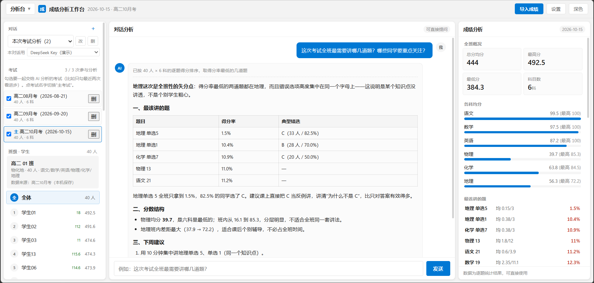
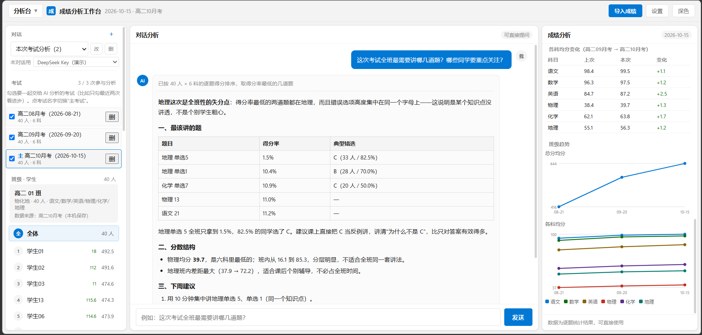
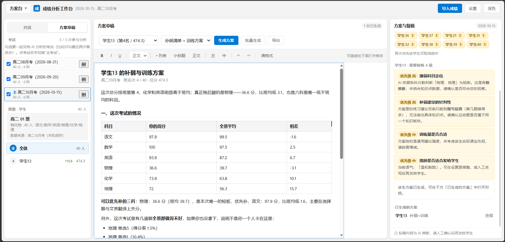
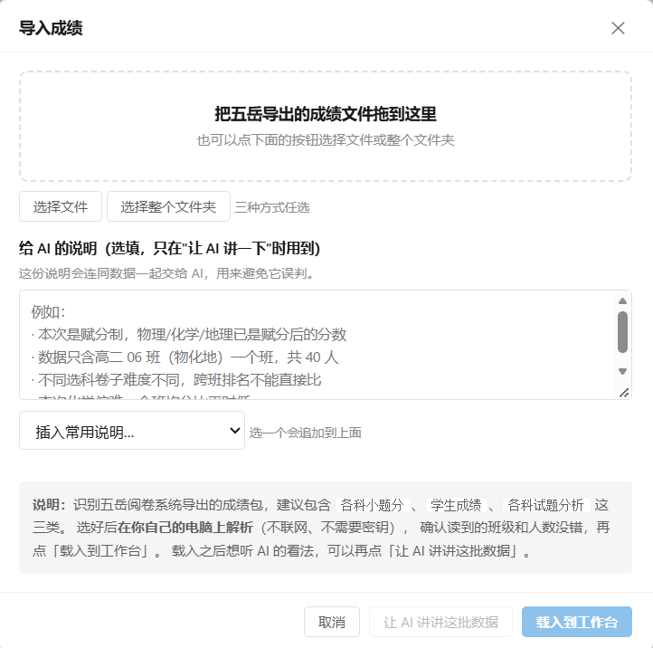
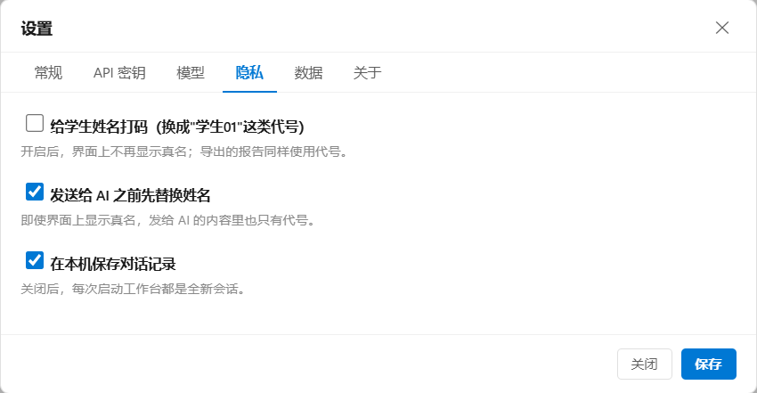

> 🌏 This README is in Chinese. If you don't read Chinese, please read the **[English version (README-en.md)](README-en.md)**.

# 成绩分析工作台

> 给高中班主任的成绩分析工具：导入五岳阅卷系统导出的成绩表，自动算统计、找短板，再用 AI 生成每个学生的补弱清单与两周训练方案。

## ⚠️ 写在最前面

本项目是一个 16 岁高中生，根据自己班主任的真实教学需求，完全通过 **Vibe Coding（用自然语言下指令）** 做出来的。

**没有手写任何一行代码。** 从五岳导出文件的底层解析、前端界面，到自动化测试和打包脚本，全部由 Agent 完成（包括你现在正在看的这篇 README 的初稿）。

我负责的部分是：产品设计、需求拆解、逻辑架构、质量验收（测试）以及体验吐槽。

| | |
|---|---|
| 当前版本 | v0.1（实验性质，局限见下文第七节） |
| 运行环境 | Windows 10 / 11 · 64 位 |
| 开发工具 | DeepSeek Harness |
| 底层模型 | DeepSeek V4.1 Flash |
| Token 消耗 | 截至 2026-10-17 23:48，约 **602M tokens** |
| 总花费 | 约 **19 元人民币** |

**为什么选 Apache-2.0，而不是更常见的 MIT：考虑到专利风险。** MIT 只给版权许可，对专利一个字都没提；Apache-2.0 在版权之外还附一条明确的专利授权，并带"专利报复"条款——拿专利来告这个项目的人，他对本项目享有的专利许可会自动终止。这个工具很可能被别的老师、学校甚至公司拿去继续开发和商用，用 Apache-2.0 对使用者更稳，对作者也更安全。协议全文见 [`LICENSE`](LICENSE)，归属声明见 [`NOTICE`](NOTICE)，第三方组件见 [`THIRD-PARTY-NOTICES.md`](THIRD-PARTY-NOTICES.md)。

*如果你也是一名老师，希望它能帮你减轻一点工作负担；如果你是开发者，希望这能给你提供一个 AI 时代软件开发的"新范式"样本。*

---

## 一、这是什么

一个**单机运行**的桌面工具，把"考完试之后那一堆数字"变成能直接发下去的东西。

**它解决的具体麻烦：**

- 五岳导出的三个表（各科小题分、各科试题分析、学生成绩）格式不统一、列名带合并单元格陷阱，老师和 Excel 搏斗半小时才能算出的东西，它拖进去就出来
- 想知道"这次哪些题全班都丢分"、"谁的排名掉了 20 名"，得一张张表翻
- 要给每个学生写补弱建议——40 个学生写 40 遍，写到最后一份已经没有质量了

**它做的两件事：**

| | 分析台 | 方案台 |
|---|---|---|
| 面向 | 全班 + 每个学生 | 单个学生 |
| 内容 | 班级概况、各科均分、最该讲的题（按得分率排序）、逐人小题得分、历次名次折线图 | 补弱清单（知识 / 题型短板）、两周训练安排、可打印的训练方案 |
| 产出 | 屏幕上看的表格与图表 | 导出 Word（`.doc`）或打印成 PDF，直接发给学生 |

尺寸上：40 人的班，从导入到出第一份方案，一般几分钟。

## 二、界面长什么样

一个页面分左右两栏：左边是学生列表和考试选择，右边是分析内容（表格、折线图、AI 对话），底部是统一的输入框。

**分析台** —— 左边勾选要一起看的考试，中间直接问 AI，右边是算好的班级数据：



**班级趋势** —— 同一页面向下滚动，历次考试的均分与各科变化连成折线（缺考处断线）：



**方案台** —— 每个学生一份补弱清单 + 两周训练安排，中间是可直接改的草稿，右侧标出 AI 结论里需要老师复核的地方：



> 上面截图里的学生叫"学生01…学生40"、学校是"示例中学"，都是**合成数据**——真实班级的数据不会出现在这个仓库里。
>
> 深色主题也做了：[看一眼深色版](docs/图片/界面-分析台-深色.png)。

不用装任何东西就能看：

1. 下载或克隆本仓库
2. 直接用浏览器打开 [`成绩分析工作台-首页.html`](成绩分析工作台-首页.html)

打开的是**空白数据版**——界面、图表、交互都在，只是没有学生。想真正跑导入和"问 AI"，请用下文第三节的启动方式（`file://` 下浏览器会拦跨域请求，AI 那一步必然失败，属于预期）。

想自己复现上面这些截图（数据全部是假的）：

```powershell
python data\make_demo_page.py     # 生成 成绩分析工作台-演示版.html
```

它会造 40 名学生（学生01…学生40）、示例中学、三场月考，打开就能看到同样的界面；
生成脚本只用合成数据，跑完还会拿真实名册当黑名单自查一遍"页面里没有真实姓名"。

## 三、给老师：解压即用（Windows）

去 [Releases](../../releases/latest) 下载 **`成绩分析工作台-v0.1.0-windows-x64.zip`**（约 192 MB），解压后双击 **`启动.bat`**，浏览器会自动打开界面（`http://127.0.0.1:3080/`）。

- 不需要装 Node、Python、数据库；压缩包里已经带好运行环境
- 关闭：双击 `停止.bat`（只结束占用 3080 端口的进程，不动别的程序）
- 详细说明：解压后同目录的 `使用说明.txt`（全中文、无技术术语）

**两个常见的第一道坎：**

| 现象 | 原因与处理 |
|---|---|
| "Windows 已保护你的电脑" | 文件没有商业代码签名（个人项目负担不起）。点 **更多信息 → 仍要运行** |
| 杀毒软件报未知程序 | 同上，属于"没见过的 exe"。可以把文件夹加进信任区，或者用源码自己构建 |

**解压路径请尽量短**：包内文件路径最深接近 200 字符，套在很深的文件夹里可能解压失败（Windows 的老毛病）。

**它需要你准备：** 一个 DeepSeek API Key（在 DeepSeek 开放平台申请，按量计费，很便宜），以及五岳导出的成绩文件。

**导入成绩** 就是把五岳导出的那个文件夹（或三个表）拖进这个窗口，认不出来的文件它会告诉你：



## 四、给开发者：从源码构建

```powershell
# 1) 装测试依赖（只有跑测试才需要）
npm install

# 2) 从仓库里的合成样例数据生成 home_data.json
python data\gen_home_data.py

# 3) 跑测试
python data\run_tests.py

# 4) 构建出可双击运行的程序目录（会从 npm 装 DSH、复制 node 运行时）
python data\bootstrap.py
python data\bootstrap.py --check     # 只想先看环境是否齐全
```

构建完成后 `DSH成绩分析工作台\` 里就是成品，双击 `启动.bat` 使用（该目录被 `.gitignore` 排除）。

**打对外发布包**（改名 + 附第三方许可证 + 隐私自检，发布到 Releases 用这个）：

```powershell
python data\make_release_zip.py      # 产物在 build\ 下
python data\test_release_zip.py      # 端到端验证：解压 → 起服务 → 查注入 → 清理
```

目录结构、各脚本职责、测试清单见 [`项目结构说明.md`](项目结构说明.md)。

> **仓库里的成绩数据是合成的**：`data/fixtures/wuyue-export/` 里的三个 xlsx 由真实导出改写而来——
> 姓名换成"同学01…同学40"、学校换成"示例中学"、分数全部随机化，但**工作表划分、列顺序、
> 合并单元格陷阱都原样保留**（那些正是解析器必须处理的脏结构）。所以它能用来测代码，不代表任何真实班级。

## 五、数据与隐私

这是本项目最在意的部分，因为处理的是**未成年人的成绩单**。

| | |
|---|---|
| 成绩、名单、生成的方案 | 只存在**你自己电脑的浏览器本地存储**和程序目录里，不上传任何服务器 |
| 什么情况下会联网 | 只有你点"问 AI"的时候，直连 `api.deepseek.com` |
| 发出去的是什么 | 默认**先把学生姓名换成代号**（"学生01""学生02"）再发，AI 写回来的内容自动换回真名；界面、打印出来的仍是真名 |
| API Key | 只存在本机浏览器里 |
| 解析、统计、图表 | 全部在浏览器里算，没有后端，没有第三方统计代码 |

另有"给学生姓名打码"开关：打开后屏幕上和打印稿都只显示代号，给学生看屏幕或投屏时用。



**要注意的：** 数据存在浏览器本地存储里，**换电脑、换浏览器、清理浏览数据都会丢**。请定期用「设置 → 数据 → 备份与恢复 → 导出备份」存一个 `.json`（备份里可以选是否包含 API Key，包含就是明文，自己保管好）。

## 六、功能一览

- **导入**：整文件夹拖进去，自动识别三个表并合并；支持分批补充数据（同一次考试分两次导出也能合起来）
- **多考试**：可以同时存多次周测/月考/期中期末，勾选参与对比，指定一次"主考试"；历次名次趋势自动连成折线（缺考处断线，不会假装有分）
- **分析**：班级概况、各科均分、最该讲的题、逐人小题得分、名次变化
- **AI 分析**：把选中的内容交给模型，产出补弱清单、共性错因、复习建议；可以追问、可以接着上次聊
- **导出**：单人或全班批量导出 Word（`.doc`，可再另存 PDF），每人单独一页
- **脱敏与打码**：见上一节
- **备份**：JSON 全量导出/恢复，含多次考试

## 七、"全是 AI 写的"这件事，也说点实话

**它为什么还能用：**

- 解析器有一份 Python 参考实现，JS 版必须与它**逐字段一致**才算通过（`test_parse_parity.js`）
- 244 个检查点的自动化测试，覆盖导入、脱敏、导出、备份恢复、API 参数、多考试隔离、图表
- 合并逻辑有恒等测试：把真实数据切成两半再合回去，必须还原成原样
- 交付前有体检脚本（`preflight.py`）：结构、编码、全盘扫真名、一致性
- 踩过的坑全部记在 [`docs/开发记录.md`](docs/开发记录.md) 里，包括失败与推翻过的设计——那份记录比代码更能说明"AI 写出来的东西是怎么被逼着合格的"

**它的局限也写在这里：**

- 界面是一个 5500 行的**单文件 HTML**（由 `data/gen_home_html.py` 生成），想看代码的人会读到怀疑人生；这是为了让"双击就能跑、离线可用"而做的取舍
- 错误提示是按真实踩到的坑一条条补的，不可能覆盖所有边角
- **没有知识点数据**：五岳的导出里只有题号和得分，所以 AI 说的"知识漏洞"其实是根据题目得分率推的，界面里已标注这个边界
- 一次只处理一个班；只支持 64 位 Windows

## 八、协议

| 对象 | 协议 |
|---|---|
| 本项目自己的代码（界面、解析器、启动器、构建脚本、测试） | **Apache-2.0**（见 [`LICENSE`](LICENSE)） |
| 版权与归属声明 | [`NOTICE`](NOTICE) |
| 随包分发的第三方代码 | 保留各自协议，原文见 [`licenses/`](licenses/)，清单见 [`THIRD-PARTY-NOTICES.md`](THIRD-PARTY-NOTICES.md) |

一句话说明 Apache-2.0 允许什么：**谁都可以免费使用、修改、再发布，包括商用；但必须保留版权与协议声明、说明你改了哪里，并且不能用作者的名义为你自己的版本背书。** 相比 MIT，它多了那条明确的专利授权，这也是选它的原因。

> **关于"非官方"**：本项目把 [DeepSeek Harness](https://www.npmjs.com/package/@deepseek-ai/dsh)（MIT）当作运行外壳，而**不是** DeepSeek 的官方产品，与 DeepSeek 没有隶属、合作或背书关系。发布版因此把软件名定为「成绩分析工作台」，不含 DSH 前缀。
>
> **关于再分发的义务**：发布包里含有 DSH、Node.js、libvips 等第三方二进制，所以必须随附许可证原文（尤其 libvips 属于 LGPL-3.0，需要提供源码获取方式）。这些都在 `licenses/` 里备齐了，[`licenses/README.txt`](licenses/README.txt) 写明了每个组件的版本、来源和源码地址。

## 九、致谢

- [DeepSeek Harness](https://github.com/deepseek-ai/deepseek-harness)（[官网](https://www.deepseek.com/harness/)）—— 整个程序的外壳，也是这次"用自然语言写软件"的实验场
- [SheetJS](https://sheetjs.com/) —— 浏览器里读 xlsx
- [jsdom](https://github.com/jsdom/jsdom) —— 在 Node 里跑界面做端到端测试
- 以及 `app-0.2.1` 里那 500 多个依赖的作者们

## 十、其它文档

| 文档 | 内容 |
|---|---|
| [`docs/开发记录.md`](docs/开发记录.md) | 从需求到成品的完整过程：做过什么、推翻过什么、踩过哪些坑、为什么这么选 |
| [`docs/exe化改造记录.md`](docs/exe化改造记录.md) | 把它做成"双击 exe 开浏览器"的那一段专门记录 |
| [`项目结构说明.md`](项目结构说明.md) | 目录树、快速开始、测试清单 |
| [`docs/文档索引.md`](docs/文档索引.md) | `docs/` 里装什么 |
| [`THIRD-PARTY-NOTICES.md`](THIRD-PARTY-NOTICES.md) | 用了哪些第三方代码、各自什么协议、分发成品时的额外义务 |

---

**一句话结尾**：这个项目没有一行手写代码，但它有 244 个检查点的测试、一份把失败也写进去的开发记录，以及一个真实教学场景里提出来的需求。如果你要用它，请先备份学生的数据；如果你要改它，欢迎。
